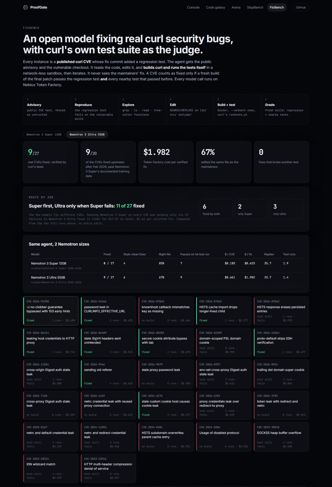

<div align="center">

# ProofGate

**AI made fake security reports free to produce. ProofGate makes proving them cheap.**

Evidence-first triage for vulnerability reports: every claim is checked against the real code,
at the exact version, before a volunteer maintainer spends an hour on it.

Built on **NVIDIA Nemotron 3** via **Nebius Token Factory** · **Tavily** · **NVIDIA OpenShell**

**SlopBench:** 0 of 148 real curl CVEs wrongly dismissed, $0.007 per report ·
**FixBench:** Nemotron fixed **11 of 27 real curl CVEs**, each verified by curl's own test suite

**[▶ Live demo: proofgate-ten.vercel.app](https://proofgate-ten.vercel.app)** · **[▶ Video (2:46)](https://youtu.be/d4L-x6sTMmI)** · [SlopBench](#slopbench-measured-on-curls-own-record) · [FixBench](#fixbench-nemotron-fixing-real-curl-cves-judged-by-curls-own-tests) · [Architecture](docs/ARCHITECTURE.md)


</div>

## The problem

curl runs on billions of devices and is maintained by volunteers. On 2026-01-26 the project
committed [`BUG-BOUNTY.md: we stop the bug-bounty end of Jan 2026`](https://github.com/curl/curl/commit/ca7ef4b817):
its HackerOne bounty had been flooded with AI-generated reports. The file now says a bounty gives
people incentives to make up "problems" in bad faith. curl's maintainer keeps a
[public list of AI slop reports](https://gist.github.com/bagder/07f7581f6e3d78ef37dfbfc81fd1d1cd):
49 entries as of October 2026, each one cost a volunteer real time to disprove.

These reports cite functions that never existed, line numbers past the end of the file, and code
nobody wrote. Disproving them does not need another model's opinion. It needs the git history.

## What ProofGate does

ProofGate is an open-source agent that checks every incoming report against the real repository,
and for reproduced bugs goes all the way to a tested patch. **A human always makes the final call,
and ProofGate never writes exploit code.**

| | Stage | How | Model / tool |
|---|---|---|---|
| 1 | **Intake** | Splits prose, quoted code, the reporter's own PoC and logs; reads screenshots | Nemotron 3.5 Super VL |
| 2 | **Claims** | Every checkable claim as JSON: file, function, line, version, code, CVE | regex + Nemotron 3 Nano |
| 3 | **Grounding** | `git show/grep/ls-tree` at the claimed version, full-history pickaxe, tree-sitter call graph; then reasoning over the real functions | git, tree-sitter, Nemotron 3 Super |
| 4 | **Prior art** | curl's 239 official advisories, OSV.dev, and a live web search of disclosures and issues | Tavily, OSV |
| 5 | **Policy** | A rulebook built at runtime from the project's own "not a security issue" policy (19 rules for curl) | Nemotron 3 Super |
| 6 | **Reproduce** | Runs only the reporter's steps, in an ephemeral sandbox with no network and no secrets; attributes any crash to project code or reporter code | NVIDIA OpenShell / Docker |
| 7 | **Verdict** | A rule table decides; Ultra explains, then argues the reporter's side | Nemotron 3 Ultra |
| 8 | **Fix** | For reproduced bugs: patch, `git apply --check`, rebuild, rerun, run the area's tests, iterate; draft PR on a fork | Nemotron 3 Super |
| 9 | **Evidence card** | Verdict, line-linked ledger, claimed-vs-real diff, duplicates, cost, reply draft | |

Verdicts: 🔴 **UNGROUNDED** · 🔵 **DUPLICATE** · 🟠 **NEEDS INFO** · 🟢 **REPRODUCED**

### The two guarantees

1. **Only proof can dismiss.** `UNGROUNDED` requires deterministic contradictions (a function that
   never existed in any commit, a line past the end of the file, quoted code that never appeared)
   that outweigh what checks out. Model output can explain, challenge or downgrade a verdict, never
   create a dismissal.
2. **Time-travel grounding.** A report is checked against the release it names, or the newest release
   on the day it was filed, and against the default branch as of that date. Renamed or removed code is
   reported as such ("`lib/vtls/nss.c` existed until 2023-07-29"), never as invented.


## What it looks like

| Triage console | Code galaxy |
|---|---|
|  |  |
| Nine stages light up live with time and Token Factory spend; the 3D galaxy reacts. | All 4,291 functions and 9,747 calls of curl 8.23.0 (tree-sitter). Real paths glow; invented functions float outside, connected to nothing. |

| Adversarial arena |
|---|
|  |
| A red-team agent writes fakes that get closer to the truth each level (real file, real function, real quoted code, then text aimed at the AI). Offline rounds: **ProofGate 10, red team 0.** |

## SlopBench: measured on curl's own record

[`bench/slopbench.jsonl`](bench/slopbench.jsonl) indexes **197 disclosed curl reports**:
**49 slop** (every entry on the public slop list) and **148 valid** (every curl CVE whose
advisory links the original HackerOne report). Report text is fetched from HackerOne's public JSON
into a local cache and is not redistributed. A report's own advisory, its own page and the slop
list itself are excluded from prior art, so ProofGate cannot look up the answer.

<!-- BENCH:START -->
| Configuration | Slop closed with proof | Real CVEs wrongly dismissed | Real CVEs closed as duplicate | Agreement with curl | Cost / report | Time / report |
|---|---|---|---|---|---|---|
| Deterministic only (git + tree-sitter + advisories) | 12% (6/49) | **0** / 148 | 2 | 77% | $0.0000 | 8.0s |
| Full pipeline (routed Nemotron + Tavily) | 8% (4/49) | **0** / 148 | 2 | 76% | $0.0071 | 56.9s |
| Ablation: no grounding | 0% (0/49) | **0** / 148 | 2 | 74% | $0.0071 | 42.1s |

_Not yet run: Ablation: Nemotron Ultra for every role._

_Generated 2026-10-25T05:01:18Z by `proofgate bench table`._
<!-- BENCH:END -->

**How to read this.** "Slop closed with proof" counts reports ProofGate would close with a
deterministic contradiction or a matching published advisory. Everything else gets **NEEDS INFO**:
real code is cited but nothing proves the bug, so the maintainer receives the evidence ledger and
a reply draft asking for a reproduction instead of an hour of investigation. "Real CVEs wrongly
dismissed" is the number that must stay at or near zero: those were genuine vulnerabilities.

**What the ablation shows.** With the same Nemotron models and Tavily but without git grounding,
ProofGate closes **no** slop at all, and its credibility ranking of the NEEDS INFO queue drops to
chance (AUC 0.53, vs 0.67 with grounding). The models alone cannot tell a fabricated report from a
real one; the evidence comes from checking the claims against the code. In the full pipeline
Nemotron Ultra's adversarial pass is deliberately conservative: it handed 2 of the 6 deterministic
dismissals back to a human, which is why the full run closes 4 rather than 6.

**A caveat found after these runs.** On Oct 25 we measured that Nemotron 3 on Token Factory ignores
the `/no_think` system-prompt switch these runs used: a JSON stage could spend its whole token
budget reasoning and return no content, so on long reports claim extraction fell back to the regex
extractor and some adversarial passes were skipped. The engine now switches reasoning with
`chat_template_kwargs.enable_thinking` (the same real report went from 38-60 s to 17-22 s, every
call parsing on the first try) and counts failed attempts in the run's cost. The table is what the
engine did before that fix; it has not been rerun yet.

Reproduce: `proofgate bench build && proofgate bench fetch && proofgate bench run --config deterministic`
(or `--config full` with Token Factory and Tavily keys).

## FixBench: Nemotron fixing real curl CVEs, judged by curl's own tests

Triage is half the job. For a real bug, ProofGate's fix agent writes the patch, and FixBench measures
whether it actually works, the same way coding agents are measured on SWE-bench, but on security bugs
in a 30-year-old C codebase.

**Instances** ([`bench/fixbench.jsonl`](bench/fixbench.jsonl)) come from curl's official advisory feed:
every CVE since 2023 whose fix commit added a regression test (29 candidates, most of them published
in 2026). For each one:

- **base** = the parent of curl's fix commit, i.e. the vulnerable code;
- **fail-to-pass** = the regression test the curl maintainers wrote with the fix;
- **pass-to-pass** = up to 30 existing tests in the same area (shared test keywords);
- **gold patch** = the maintainers' fix, used only to validate the instance, **never shown to the agent**.

An instance is kept only if, in our sandbox build, its regression test **fails on the vulnerable commit
and passes with the maintainers' fix**. Dropped instances are listed with the reason, not hidden.

**The agent** ([`engine/proofgate/fixbench/agent.py`](engine/proofgate/fixbench/agent.py)) is a
native tool-calling loop on Token Factory. It gets the public advisory (fenced as untrusted text)
and the vulnerable checkout:

1. **Reproduce.** It runs the regression test on the untouched build and sees the real failure.
2. **Explore.** `grep`, `ls`, `read`, tree-sitter `outline`/`function`, plus a deterministic first pass
   that locates the identifiers the advisory names.
3. **Edit.** Exact search/replace edits, limited to `.c/.h` files under `lib/`, `src/`, `include/`.
   Edits to tests or build files are refused.
4. **Build and test.** `run_tests` compiles curl (debug build, ccache) and runs curl's own `runtests.pl`
   in a Docker sandbox with `--network none`, a read-only root, no capabilities and hard limits. The
   regression test runs under valgrind, as in curl's CI, so memory errors fail it too. curl's own
   `checksrc.pl` style checker runs on the changed files. Failures (compiler errors, protocol diffs,
   valgrind reports, style warnings) go back to the model, and it iterates, up to 4 test runs and
   40 replies. If a later edit breaks a passing patch, the agent falls back to its last green one.

**Grading is strict.** A CVE counts as fixed only if a fresh build of the agent's final diff passes every
fail-to-pass test **and** every pass-to-pass test. Style is reported separately ("style-clean"), so
an indentation slip is never counted as a broken build.

<!-- FIXBENCH:START -->
| Agent model (Token Factory) | Resolved | Style-clean (checksrc) | Fixed on 1st test run | Edited the right file | Broke other tests | Cost / CVE | Cost / fix | Time / CVE |
|---|---|---|---|---|---|---|---|---|
| `nvidia/NVIDIA-Nemotron-3-Nano-30B-A3B` | **2 / 27** (7%) | 1 | 2 | 30% | 0 | $0.048 | $0.644 | 11.5 min |
| `nvidia/nemotron-3-super-120b-a12b` | **8 / 27** (30%) | 4 | 7 | 85% | 0 | $0.185 | $0.623 | 3.9 min |
| `nvidia/Nemotron-3-Ultra-550b-a55b` | **9 / 27** (33%) | 6 | 9 | 67% | 0 | $0.661 | $1.982 | 2.7 min |
| Cascade: Super on every CVE, Ultra only on Super's 19 failures (computed from the two runs) | **11 / 27** (41%) | | | | | $0.662 | $1.625 | |

_27 of 29 candidate CVEs validated (regression test fails on the vulnerable commit and passes with curl's fix in the sandbox). Generated 2026-10-25 by `proofgate fixbench table`._
<!-- FIXBENCH:END -->

**What this says about Nemotron sizes.** Super and Ultra fix *different* CVEs: 6 are fixed by both, 2
only by Super, 3 only by Ultra. Ultra passes on its first test run every time it succeeds and is
faster in wall time, but costs about 3.5x more per CVE. So ProofGate routes by job here too: Super
first, Ultra only on Super's failures, which fixes the most CVEs (11 of 27) at a lower cost per fix than
Ultra alone. No fix broke a nearby test. All 9 of Ultra's fixes and 7 of Super's 8 are for CVEs fixed
upstream after February 2026, past Nemotron 3 Super's documented training data. Nano (30B, 3B active)
fixes 2 of 27 at $0.05 per CVE and reaches the right file only 30% of the time: fine for extracting
claims, too small for multi-step C repair, which is why the triage pipeline gives it only that job.



Every transcript, the agent's diff and the maintainers' diff are on the
[FixBench page](https://proofgate-ten.vercel.app/fixbench/). Methodology, dropped instances and threats
to validity: [docs/FIXBENCH.md](docs/FIXBENCH.md). Reproduce (Docker required):
`proofgate fixbench validate && proofgate fixbench run --model super && proofgate fixbench table`.

## Built on Nebius + NVIDIA

**Every model call goes through Nebius Token Factory** with the official `openai` SDK
(`base_url=https://api.tokenfactory.nebius.com/v1/`). Model ids are resolved at startup from
`GET /v1/models`, so the app keeps working as ids evolve. Each Nemotron size has exactly one job:

| Role | Token Factory model id | Job | Why this size | $ / 1M tokens (in / out) |
|---|---|---|---|---|
| nano | `nvidia/NVIDIA-Nemotron-3-Nano-30B-A3B` | claims as JSON | high volume, latency-sensitive | 0.06 / 0.24 |
| super | `nvidia/nemotron-3-super-120b-a12b` | real-source reasoning, policy, patches, red team | long context over real code | 0.30 / 0.90 |
| ultra | `nvidia/Nemotron-3-Ultra-550b-a55b` | verdict explanation + adversarial challenge | strongest reasoning, two calls per report | 1.00 / 3.00 |
| omni | `nvidia/Nemotron-3.5-Super-VL` | screenshots, terminal captures | the vision model on Token Factory | 0.30 / 0.90 |

Measured live on a real report, [HackerOne #3418528](https://hackerone.com/reports/3418528) from
curl's public slop list, fetched at run time: **UNGROUNDED in 21.6 s for $0.0084**. Nano extracted
10 claims, git searched 40,192 commits for the cited `Curl_ldap_err2string()` (never existed),
Tavily searched for prior disclosures, Super applied curl's policy, Ultra explained the verdict and
then argued the reporter's side (the verdict stood). The engine's log of that run, one line per call
with model, tokens and cost, is in [`video/runs/`](video/runs/). Prices are the Token Factory list
prices used by the live cost counter.

- **Reasoning on and off.** Nemotron 3 reasons by default; ProofGate turns it off for its JSON stages
  with `chat_template_kwargs: {"enable_thinking": false}`. A `/no_think` line in the system prompt is
  ignored by all three sizes on Token Factory (measured: reasoning tokens still returned).

- **Cost is a product feature.** Every call records tokens, latency and USD; the console shows live
  spend; `PG_MAX_COST_PER_REPORT` (default $0.25) aborts a run over budget; the public server caps
  daily spend. The deterministic stages handle the bulk of the work for $0.
- **NVIDIA OpenShell** runs reproductions through its Python SDK (`SandboxClient.create_session`
  → `exec` → `delete`) under OpenShell's default-deny network policy with no providers attached.
  A Docker backend (`--network none`, read-only root, dropped capabilities, PID/memory/CPU limits)
  is the fallback.
- **Nebius AI Cloud**: the engine ships as a container (`engine/Dockerfile`) for a Nebius VM or
  Serverless Endpoint; the demo front end is static.
- **Tavily** is called at runtime in the prior-art stage, scoped to disclosure and advisory domains.

## Quick start

**One command** (engine on :8000, web on :3000):

```bash
docker compose up --build
```

Add keys for live mode: copy `engine/.env.example` to `engine/.env` and set `NEBIUS_API_KEY`
(hackathon credits code `NEBIUS-DEVPOST-GLOBAL26`) and `TAVILY_API_KEY`.
Without keys the deterministic stages, the replays, the galaxy and the arena all still work.

Local development:

```bash
pip install -e "./engine[dev]"      # Python 3.11
proofgate check bench/samples/01-ghost-function.json --offline
proofgate arena --offline
proofgate serve                     # API on :8000
cd web && npm ci && npm run dev     # UI on :3000 (NEXT_PUBLIC_API_URL=http://localhost:8000 for live)
```

## GitHub Action

Any project can run ProofGate on issues labeled `security-report`; see
[`action/example-workflow.yml`](action/example-workflow.yml):

```yaml
- uses: Mohammad-Umar7/proofgate/action@main
  with:
    nebius-api-key: ${{ secrets.NEBIUS_API_KEY }}
    tavily-api-key: ${{ secrets.TAVILY_API_KEY }}
```

The triage step receives model keys but **no GitHub token**; a separate posting step comments the
evidence card. It works on any C repository with release tags (`tag-prefix`, `source-dirs` inputs).

## Security of ProofGate itself

- Report text is untrusted data: fenced in a randomized tag on every model call, and scanned for
  text that addresses the triage model (flagged on the card, never obeyed).
- The reasoning stages hold no credentials and cannot post, push or merge. Only the orchestrator
  (`publish.py`) holds a token, and it only opens **draft** PRs on a fork, never upstream.
- Sandboxes are ephemeral, network-less, credential-less and resource-limited.

## Hosted demo

**https://proofgate-ten.vercel.app**: no login, no backend required, so it stays up through
judging. It is a static export of `web/` on Vercel (root directory `web`, redeployed on every push
to `main`): recorded runs of real curl reports in the console, the code galaxy, the arena and
SlopBench and FixBench. No model calls, so it costs nothing to keep up.

## Live mode

Run the engine with keys (`proofgate serve`) and build or run the site with
`NEXT_PUBLIC_API_URL=http://127.0.0.1:8000`:

- **Console:** paste a link to a disclosed HackerOne report (the engine fetches its public text at
  run time) or paste a report, and watch the nine stages run against curl with live time and
  Token Factory spend.
- **FixBench:** every CVE gets **Run live now**: the agent reproduces the bug, explores, edits, builds
  curl and runs its tests in the Docker sandbox while the page streams each step, the test lights and
  a live clock and spend. Only accepted from the engine's own machine, since it builds curl locally.
  Filmed on Oct 25: Nemotron 3 Super fixed CVE-2026-6276 live twice (61 s and $0.034, 68 s and $0.043;
  all 30 tests pass, checksrc clean).

## Video

**[Watch on YouTube: https://youtu.be/d4L-x6sTMmI](https://youtu.be/d4L-x6sTMmI)**

A 2:46 film made from the live runs above: the HackerOne report triaged with the engine's real log
beside the console, the code galaxy, the pipeline, SlopBench, the live CVE fix and FixBench, with
subtitles and an on-screen highlight on whatever the narration names. How it is produced and rebuilt:
[`docs/VIDEO.md`](docs/VIDEO.md); the narration: [`video/SCRIPT.md`](video/SCRIPT.md).

## Repository

```
engine/   Python 3.11 package `proofgate`: pipeline stages, sandbox, bench, FastAPI server, CLI
web/      Next.js + React Three Fiber: gate hero, console, code galaxy, arena, SlopBench
bench/    SlopBench index, synthetic samples, results
action/   GitHub Action
docs/     architecture, hackathon brief, video script, feedback
```

Feedback on Token Factory, AI Cloud and Nemotron: [`docs/FEEDBACK.md`](docs/FEEDBACK.md).

Apache-2.0. Built for the Nebius x NVIDIA Global AI Hackathon 2026 (Coding and Agentic Engineering).
