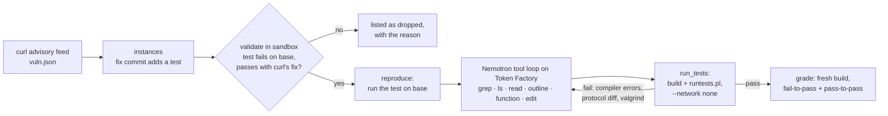

# Architecture

```mermaid
flowchart LR
  R[Report<br/>text, screenshots] --> I[1 Intake<br/>Nemotron 3.5 Super VL]
  I --> C[2 Claims<br/>regex + Nemotron Nano]
  C --> G[3 Grounding<br/>git + tree-sitter<br/>+ Nemotron Super]
  G --> P[4 Prior art<br/>curl advisories, OSV, Tavily]
  P --> RU[5 Policy<br/>SECURITY rulebook]
  RU --> S[6 Reproduce<br/>OpenShell / Docker sandbox]
  S --> A[7 Verdict<br/>rule table + Nemotron Ultra<br/>+ adversarial pass]
  A -->|REPRODUCED| F[8 Fix loop<br/>patch, rebuild, test]
  A --> E[9 Evidence card]
  F --> E
  E --> O[Orchestrator<br/>posts comment / draft PR]
```



## Principles that shape the code

1. **Cheap and certain first.** Stages 1–5 answer most reports with git plumbing and a parser.
   A full-history search of curl's 40,000+ commits takes about four seconds and costs nothing.
2. **Only proof can dismiss.** `adjudicate.rule_table` returns `UNGROUNDED` only when deterministic
   contradictions outweigh what checks out. Model output (`deterministic=False` evidence) can explain,
   challenge or downgrade a verdict, never create a dismissal.
3. **Time-travel grounding.** A report is checked against the release the reporter named, or the
   newest release on the day it was filed, plus the default branch as of that date. Code that was
   renamed or removed later is reported as such, never as invented.
4. **The reporter's code is not the project's code.** Functions defined in a report's own snippets,
   files the report compiles or saves, and proposed patches are excluded from claims about the project.
5. **Report text is data.** Every model call fences the report in a randomized tag with an explicit
   guard; `security.scan_injection` flags reports that address the triage model.

## Model routing on Nebius Token Factory

| Role | Model family | Job | Why this size |
|---|---|---|---|
| `omni` | Nemotron 3.5 Super VL | transcribe screenshots and terminal captures | the vision model on Token Factory |
| `nano` | Nemotron 3 Nano | extract claims as JSON | high volume, structured output |
| `super` | Nemotron 3 Super | read real source, judge reachability and guards, apply policy, write patches | long context over real code |
| `ultra` | Nemotron 3 Ultra | explain the verdict, then argue the reporter's side | strongest reasoning, called twice per report |

Model ids are resolved at startup from `GET /v1/models` (override with `PG_MODEL_*`). Every call is
recorded with tokens, latency and cost; `PG_MAX_COST_PER_REPORT` aborts a run that exceeds its budget.

## FixBench: the fix agent and how it is measured



- **Harness** (`fixbench/harness.py`). One toolchain image (`sandbox/Dockerfile.curl-test`, with
  stunnel, sshd and valgrind for curl's own test servers). Every run unpacks a `git archive` of the
  base commit into a tmpfs, applies the regression test and the candidate patch, builds with a shared
  ccache volume and runs `runtests.pl`. Autotools output is cached per instance (keyed by image and
  configure flags), so a build-and-test cycle takes about a minute. The container has no network,
  no capabilities and a read-only root; the test servers bind to loopback.
- **Agent** (`fixbench/agent.py`). Native function calling on Token Factory, so the model can never
  invent a tool result. It works on an in-memory overlay of the vulnerable tree, can only edit
  `.c/.h` files under `lib/`, `src/`, `include/`, and has a budget of 30 replies, 4 test runs and a
  dollar cap. A deterministic first pass gives it the files where the advisory's identifiers occur.
- **Grading** (`fixbench/run.py`). Resolved only if a fresh build of the final diff passes every
  fail-to-pass and every pass-to-pass test. The maintainers' fix is used only to validate instances.
- **Relation to stage 8.** The triage pipeline's fix stage (`stages/fix.py`) is the earlier
  single-call patch loop, driven by the reporter's reproduction. The FixBench agent is its
  tool-calling successor; moving stage 8 onto it (with the reproduction as the failing test) is the
  next step.

## Evidence model

Each claim produces `Evidence(status, method, deterministic, detail, file, line, url, data)`:

| status | meaning |
|---|---|
| `verified` | the code says what the report says |
| `contradicted` | provably not true at that version (and, for names, nowhere in history) |
| `partial` | real, but elsewhere: another file, another version, an external API, removed later |
| `unverifiable` | nothing to check deterministically |

## Security model

- The reasoning stages receive model keys but no GitHub credentials; only `publish.py` (the
  orchestrator) holds a token, and it only opens **draft** PRs on a fork the operator controls.
- Reproduction runs the reporter's own steps only, in an ephemeral sandbox: OpenShell with its
  default-deny network policy, or Docker with `--network none`, a read-only root, all capabilities
  dropped, `no-new-privileges`, and PID, memory and CPU limits.
- The public demo caps spend per report and per day and rate-limits per address.

## Repository layout

```
engine/proofgate/
  config.py llm.py schema.py security.py repo.py codeindex.py advisories.py tavily.py
  stages/   intake claims grounding prior_art rules repro adjudicate fix card
  sandbox/  base (Docker) openshell sanitizer images Dockerfile.curl-asan
  bench/    dataset run          pipeline.py server.py arena.py export.py cli.py publish.py
web/src/
  three/gate     GPU-driven gate hero (shards, embers, membrane impacts)
  three/galaxy   code galaxy (instanced functions, call edges, path beam, ghost nodes)
  app/           landing, console, galaxy, arena, bench
bench/           SlopBench index, samples, results
action/          GitHub Action
```
